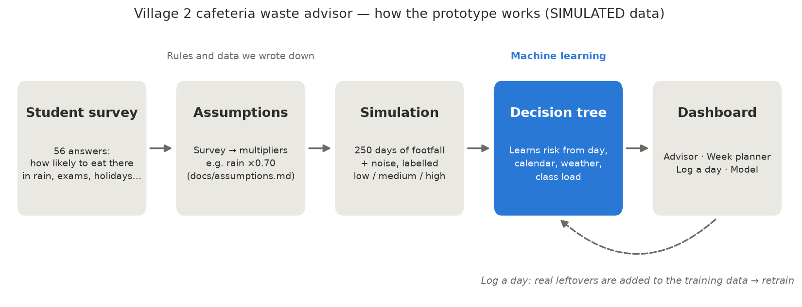

# Village 2 cafeteria waste advisor (prototype)

TEB2023 AI group project. A vendor dashboard that predicts lunch waste risk (low/medium/high) and suggests how much to cook, using a decision tree trained on days simulated from a student survey.

**All results are simulated.** See `docs/assumptions.md` for every number and where it comes from.



## Data

`data/survey.xlsx` has 56 anonymous responses to a survey about cafeteria habits: year of study, where students live, how often they eat there, meal times, and how likely they are to come during exams, on Fridays, on weekends, in heavy rain and on hazy days. It also covers food waste and how students would react to a crowd forecast.

## Run it

From the project root:

```bash
pip install -r requirements.txt
python src/simulate.py        # build data/cafeteria_days.csv (simulated)
python src/train.py           # train + evaluate -> model.pkl, docs/model_report.md and plots
python -m src.scenarios       # 5 report test cases -> docs/scenarios.md
python -m src.sensitivity     # how much each assumption matters -> docs/sensitivity.md
python src/figures.py         # system diagram -> docs/system_diagram.png
streamlit run app.py          # vendor dashboard
```

## Dashboard pages

| Page | What it does |
|---|---|
| **Advisor** | One day's waste risk, the tree's reasoning ("Why this risk?"), estimated diners, batch advice, energy tip, and similar past days |
| **Week planner** | Set conditions for 7 days; get each day's advice and the week's total meals |
| **Log a day** | Record real meals cooked and leftovers, then retrain so the model learns from real days |
| **Model** | The tree, model comparison, confusion matrix, feature importance, scenarios and sensitivity |

## Files for the report

| File | Contents |
|---|---|
| `docs/system_diagram.png` | How the parts fit together |
| `docs/tree.png` | The decision tree |
| `docs/model_report.md` | Cross-validation vs baseline and logistic regression, confusion matrix, recall, feature importance |
| `docs/confusion_matrix.png`, `docs/feature_importance.png` | Evaluation plots |
| `docs/scenarios.md` | 5 test cases with predicted risk and batch advice |
| `docs/sensitivity.md` | How results change when key assumptions change |
| `docs/assumptions.md` | Every assumption (A1–A23) in plain words |
| `docs/screenshots/` | Dashboard screenshots: inputs, low/medium/high risk, week planner, model page |
